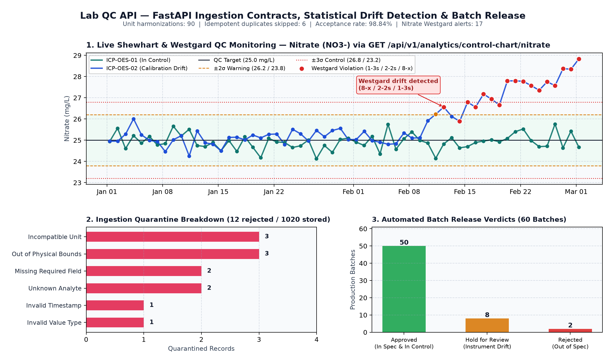

# Lab QC API

A FastAPI service for deciding which laboratory batches need review. It harmonizes instrument units, keeps invalid readings for inspection, and flags calibration drift even when a sample falls within its configured range.

**60-day synthetic demo** · 1,038 readings received · 1,020 stored · 6 duplicates · 12 quarantined. Of 60 batches, 50 were approved, 8 held for review, and 2 rejected.

[Run the demo locally](#quickstart) · [See the clean-install verification on GitHub Actions](https://github.com/xx636xx/lab-qc-api/actions/runs/45477826366)



---

## Quickstart

```bash
git clone https://github.com/xx636xx/lab-qc-api.git
cd lab-qc-api

python -m venv .venv
# Windows (PowerShell): .venv\Scripts\Activate.ps1
# macOS / Linux:        source .venv/bin/activate

pip install -e ".[dev]"

# Start the FastAPI server
python -m uvicorn lab_qc_api.main:app --reload
```

Open interactive Swagger UI at **http://127.0.0.1:8000/docs**, or run the seeded demo directly from your terminal:

```bash
# 1. Seed 60 days of deterministic multi-instrument lab data (1,038 raw records)
curl -X POST "http://127.0.0.1:8000/api/v1/demo/seed?days=60&reset=true"

# 2. Check active instrument calibration drift alerts
curl "http://127.0.0.1:8000/api/v1/analytics/drift-alerts"

# 3. Inspect an automated batch release verdict affected by instrument drift
curl "http://127.0.0.1:8000/api/v1/batches/BATCH-2026-046/release"

# 4. Download a live PNG Shewhart control chart rendered by the API
curl "http://127.0.0.1:8000/api/v1/analytics/control-chart/nitrate/plot" -o nitrate_qc.png
```

---

## Verified Sample Outputs

### 1. Partial-Success Ingestion Summary (`POST /api/v1/demo/seed`)
```json
{
  "run_id": 1,
  "source_file": "synthetic_lab_60d.json",
  "received": 1038,
  "inserted": 1020,
  "duplicates_skipped": 6,
  "quarantined": 12,
  "unit_conversions": 90,
  "acceptance_rate_pct": 98.84,
  "quarantine_breakdown": {
    "INCOMPATIBLE_UNIT": 3,
    "INVALID_TIMESTAMP": 1,
    "INVALID_VALUE_TYPE": 1,
    "MISSING_REQUIRED_FIELD": 2,
    "OUT_OF_PHYSICAL_BOUNDS": 3,
    "UNKNOWN_ANALYTE": 2
  }
}
```

### 2. Automated Batch Release Verdict (`GET /api/v1/batches/BATCH-2026-046/release`)
Even though every analyte in `BATCH-2026-046` falls within EU drinking-water specification limits (`nitrate <= 50 mg/L`, `iron <= 0.20 mg/L`), the API holds the batch because `ICP-OES-02` violated Westgard drift rules at run time:

```json
{
  "batch_id": "BATCH-2026-046",
  "verdict": "HOLD_FOR_REVIEW",
  "reasons": [
    "Instrument ICP-OES-02 was OUT_OF_CONTROL for Nitrate (NO3-) (Westgard rules: 1-2s, 8-x) at batch run time."
  ],
  "checked_analytes": 5
}
```

Across the 60 seeded production batches, the API produces **50 `APPROVED`**, **8 `HOLD_FOR_REVIEW`** (instrument drift), and **2 `REJECTED`** (genuine out-of-spec excursions on Iron in `BATCH-2026-018` and Nitrate in `BATCH-2026-049`).

---

## Key Engineering Decisions

- **Partial-success quarantine over fail-all `422`:** In real laboratory exports, a single corrupted sensor reading (`"ND"`, `pH = 16.4`, wrong unit) should never discard 200 valid measurements. Valid rows are normalized and persisted, while bad rows are captured in `quarantine_records` with machine-readable error codes and the raw JSON payload for auditability.
- **Canonical unit harmonization:** Accepted unit aliases (`ug/L`, `µg/L`, `ppb`, `ppm`, `mS/cm`) are converted into canonical storage units (`mg/L`, `uS/cm`, `pH`, `NTU`) while preserving `original_value` and `original_unit` for traceability.
- **Idempotent writes:** A composite `UNIQUE(instrument_id, batch_id, sample_id, sample_type, analyte, measured_at)` constraint with `INSERT OR IGNORE` ensures re-uploading an instrument file inserts zero duplicate rows.
- **Per-instrument Westgard isolation:** Control rules (`1-2s`, `1-3s`, `2-2s`, `8-x`) are tracked independently per instrument so calibration drift on `ICP-OES-02` never contaminates `ICP-OES-01`.

---

## API Reference

| Method | Endpoint | Purpose |
| :--- | :--- | :--- |
| `GET` | `/health` | Liveness check and current stored/quarantined row counts |
| `GET` | `/api/v1/analytes` | Supported analytes, accepted unit aliases, spec & QC limits |
| `POST` | `/api/v1/measurements/ingest` | Validate, normalize, deduplicate, and ingest raw records |
| `POST` | `/api/v1/demo/seed` | Populate deterministic 60-day multi-instrument synthetic dataset |
| `GET` | `/api/v1/quality/summary` | Global ingestion KPIs, conversions, duplicates, quarantine counts |
| `GET` | `/api/v1/quality/quarantine` | Inspect rejected records filtered by `error_code` |
| `GET` | `/api/v1/analytics/control-chart/{analyte}` | Shewhart control limits and Westgard rule violations (JSON) |
| `GET` | `/api/v1/analytics/control-chart/{analyte}/plot` | Live rendered PNG Shewhart control chart |
| `GET` | `/api/v1/analytics/drift-alerts` | Ranked active drift alerts across all instrument-analyte pairs |
| `GET` | `/api/v1/batches` | List available production batch IDs |
| `GET` | `/api/v1/batches/{batch_id}/release` | Automated `APPROVED` / `HOLD_FOR_REVIEW` / `REJECTED` verdict |

---

## Running Tests & Regenerating Visuals

```bash
# Run the full unit + integration test suite
python -m pytest -v

# Regenerate the 3-panel overview figure from live FastAPI responses
python -m lab_qc_api.cli generate-assets --output assets/qc_api_overview.png --days 60
```

## Project Structure

```text
lab-qc-api/
├── assets/
│   └── qc_api_overview.png       # Generated directly from FastAPI endpoints
├── src/lab_qc_api/
│   ├── main.py                   # FastAPI app factory, DI, OpenAPI routes
│   ├── schemas.py                # Pydantic v2 request/response contracts
│   ├── domain.py                 # Analyte specs, unit factors, physical bounds
│   ├── database.py               # SQLite schema, idempotent upsert & SQL queries
│   ├── analytics.py              # Shewhart/Westgard engine & batch release logic
│   ├── plotting.py               # Live PNG control chart & overview renderer
│   ├── generator.py              # Deterministic seeded synthetic lab generator
│   └── cli.py                    # CLI helpers (`seed`, `generate-assets`)
└── tests/
    ├── test_ingestion.py         # Normalization, quarantine codes, idempotency
    ├── test_analytics.py         # Westgard rules & HOLD_FOR_REVIEW logic
    └── test_api.py               # End-to-end FastAPI TestClient coverage
```

## License

MIT — see [LICENSE](LICENSE).
